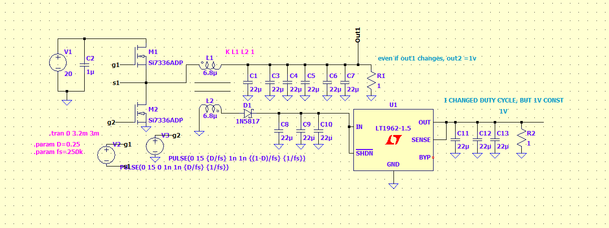

# Flybuck Converter + LDO (LTspice)

LTspice simulation of a synchronous **flybuck** (isolated-style buck) converter with a linear post-regulator on the secondary output.



## Circuit overview

| Block | Parts | Notes |
|---|---|---|
| Input | V1 = 20 V, C2 = 1 µF | |
| Primary switches | M1 (high side), M2 (low side): Si7336ADP | Driven by V2 / V3, complementary 15 V pulses |
| Coupled inductor | L1, L2 = 6.8 µH, `K L1 L2 1` | 1:1 turns ratio, ideal coupling |
| Primary output (`Out1`) | C1, C3–C7 (6 × 22 µF), R1 = 1 Ω | Buck output, ≈ D · Vin |
| Secondary output | D1 (1N5817 Schottky), C8–C10 (3 × 22 µF) | Flyback winding, conducts while M2 is on |
| Post-regulator | U1: LT1962-1.5 LDO, C11–C13 (3 × 22 µF), R2 = 1 Ω | Regulates the secondary rail |

### Parameters

```spice
.param D=0.25      ; duty cycle of the high-side switch
.param fs=250k     ; switching frequency
.tran 0 3.2m 3m    ; simulate 3.2 ms, save data from 3 ms (steady state)
```

With D = 0.25 and Vin = 20 V, `Out1` sits around 5 V. The secondary winding reflects `Out1` (1:1) minus the Schottky drop, and that rail feeds the LDO.


